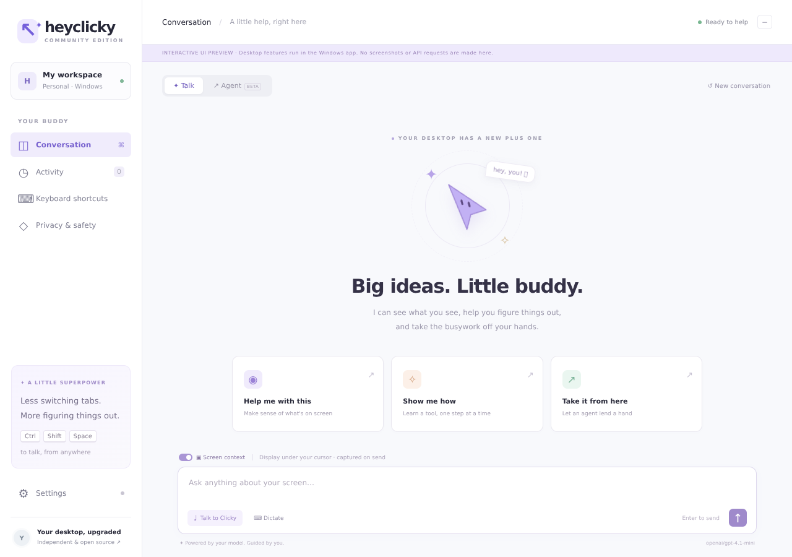

# HeyClicky Community for Windows

An independent, open-source **Windows 10/11 desktop AI buddy**, inspired by the interaction style of [HeyClicky](https://www.heyclicky.com/). Talk about your screen, get on-screen guidance, dictate into other apps, and ask an agent to perform desktop tasks—with approval before actions.

**Not the official HeyClicky app and not a full replacement for its hosted service.** No official code, branding assets, accounts or private APIs are used. See the feature comparison below. Built from the attached Windows app specification.



## New in 1.2.0

- **Expandable notch:** compact top-center companion on your primary display, hover/click to expand, Talk / Agent / Dictate / Stop / Chat quick controls, live task status and recognized text. It does not steal typing focus. Turn it off in Settings → Top-of-screen notch. It hides during screenshots and agent input, and respects display/taskbar work-area changes. Full action approval remains in the panel, not the compact notch.
- **Voice reliability:** immediately flushed native protocol, installed-recognizer selection, configurable input language, startup/turn timeouts, complete UTF-8/final-line parsing, stderr draining, and clean microphone closure before submitting a question. Cancelled listeners cannot submit stale text.
- **Microphone diagnostics:** Settings → Voice & personality → Find languages, then Test microphone. This test needs **no API key**, takes no screenshot, sends nothing to AI, and never types into another app. Windows microphone, sound and speech settings links help resolve device/permission/language problems.

## Download & run

1. Open this repository's **[Windows installer workflow](https://github.com/victor123258/HeyClicky/actions/workflows/windows.yml)**.
2. Select the latest **successful** run for `arena/95bacdb1-heyclicky` (or `main` after merging). Download **HeyClicky-Windows-x64** from the Artifacts section. GitHub requires you to sign in to download workflow artifacts. Extract the ZIP.
3. Double-click **`HeyClicky-Setup-1.2.0.exe`**. The per-user installer needs no administrator permission, creates shortcuts, and launches the app. Or run **`HeyClicky-Portable-1.2.0.exe`** without installation.
4. On first launch, paste your own [OpenRouter API key](https://openrouter.ai/settings/keys) in Settings, choose a vision/tool-capable model, and click **Save settings**, then **Test saved connection**. Your OpenRouter account needs credit. The test checks text access; image/tool support is checked during actual use.

The installer is **unsigned**. Windows may show SmartScreen or your organization may block it. Verify that you downloaded it from your own trusted build; do not disable security protections. Code signing and automatic updates are not configured. Workflow artifacts expire after 30 days; rerun the workflow to rebuild. Executables are generated by CI, not committed to Git.

**Requirements:** x64 Windows 10/11, internet access to OpenRouter and your chosen model, microphone for voice, Windows PowerShell 5.1 and a Windows speech-recognition language pack. This is an Electron app; Node.js is **not** needed to run the installer or portable executable.

## What is implemented

| Capability | This build |
|---|---|
| Screen-aware conversation | Typed or Windows speech input, OpenRouter vision models, spoken Windows voice output |
| Teaching and on-screen guidance | Model can draw labelled pointers, boxes, arrows and circles on transparent, click-through overlays |
| Top-of-screen notch | Expandable, non-focus-stealing quick controls on the primary display; task status, transcript/answer preview and stop |
| Cursor buddy | Original cursor character follows your mouse, changes color with state and moves to annotations |
| Voice agents | Agent hotkey or `agent …` prefix starts a bounded tool loop |
| Desktop actions | Click, double/right click, Unicode typing and SendKeys; uses the selected display's coordinates |
| Agent tools | PowerShell, bounded text-file reads/writes, HTTPS text fetch, browser URLs, fresh screenshots and drawings |
| Dictation | Continuous Windows speech recognition types into the currently focused application |
| Safety | Exact-argument Allow/Deny card, two-minute approval timeout, Stop button and global stop hotkey |
| Multi-monitor | Capture the display under the mouse at the start of a request; overlay on each display; Windows DPI coordinate conversion |
| Preferences | Model ID, Windows voice/rate, hotkeys, screen context, speak answers, cursor buddy, desktop approval toggle, launch on login |
| Desktop lifecycle | Single instance, tray controls, close-to-tray, one-click per-user installer and portable executable |
| Privacy | DPAPI-encrypted API key; in-memory conversation/screenshots; delete local key/settings and quit |

### Not included / different from official HeyClicky

- No official account login, subscriptions, Free/Pro/Max plans, credits or backend. **You pay OpenRouter for usage**; this app adds no subscription.
- **No native Gmail, Notion or Google Sheets OAuth connectors.** Desktop/browser automation is not equivalent to those integrations. Do not give the agent passwords, tokens or session cookies.
- Turn-based speech, not a hosted realtime voice stream. Speech accuracy and languages depend on Windows' installed recognizer. It does not listen for a wake word.
- No signed installer, updater or macOS build. No guarantee of exact visual or behavioral parity with the official app.
- No conversational memory between launches. Activity is session-only.

## Everyday use

| Default hotkey | Action |
|---|---|
| **Ctrl+Shift+Space** | Speak a question; pause to finish. Press again to cancel. |
| **Ctrl+Shift+A** | Speak an agent task. |
| **Ctrl+Shift+D** | Start/stop dictation into the active window. |
| **Ctrl+Shift+H** | Show/hide the panel. |
| **Ctrl+Shift+X** | Stop listening, speaking, requests, pending approvals and agent work. |
| **Escape** (panel focused) | Stop everything. Escape is not a global shortcut. |

Type a question and press Enter (Shift+Enter for a new line). **Talk** can only see the screen and draw; it cannot click, type or execute commands. **Agent** enables desktop tools. Saying or typing `agent` at the beginning also selects agent mode. Use “New conversation” to clear in-memory conversation and stop the current task. Closing the panel keeps the tray running; use **Quit** in the tray to fully exit.

### If voice input does not work

1. Open Settings → Voice & personality → **Find languages**. Windows speech recognition requires an installed recognition engine; a text-to-speech voice is **not** enough. Install a Speech pack under Windows Settings → Time & language → Language & region → Language options if none are listed. Only languages supported by Windows' System.Speech engine appear; not every Windows display/typing language supports recognition.
2. Select an installed **Voice input language**, then **Save settings**. Automatic uses your Windows UI language if installed, otherwise the first installed recognizer. The output voice is a separate setting.
3. Open **Microphone permissions** and enable both microphone access and **Let desktop apps access your microphone**. Under **Default input device**, choose and test your microphone. The app uses Windows' default input, not an independently selected device.
4. Click **Test microphone**. Wait for **Listening · language** before speaking. Pause at the end. The result should show **Heard: …** without calling AI. Stop cancels it.
5. If the local test works, add your OpenRouter key and use Talk. Input is phrase-based, not continuous realtime conversation; long pauses may end a question. Silence reports an error instead of leaving the app stuck indefinitely. The notch provides a Stop button even when the panel is hidden.

For dictation, put focus in the destination app **before** pressing the global hotkey. It types literal recognized text followed by a space; spoken punctuation commands are not implemented. Text goes to whichever window is focused, not necessarily the one visible at start. Do not change focus to a sensitive field while dictating.

### Approvals and emergency stop

- Clicks, keystrokes and typing ask by default. The card shows **exact tool arguments**, including commands and file contents. After Allow, the panel hides to return input to the underlying app. Verify the target app before approval.
- Commands, file reads/writes, HTTP(S) browser links and HTTPS fetches **always ask**, even if desktop approvals are disabled. File contents, command output and fetched text go to the selected model as tool results.
- Fresh screenshots and annotations do not ask separately: they are part of the screen-context request. Turn **Screen context** off for text-only conversations; screenshot tools then fail closed. No background periodic screen capture.
- Denying an action stops that agent task. Pending approval automatically denies after two minutes. No “allow everything” button.
- The agent is bounded to 12 model turns (at most 8 tool calls per turn), commands time out after 30 seconds, file reads are limited to 32 KB and writes to 32,000 characters, web results to 32 KB. Fetches do not follow redirects.
- Stop aborts network requests, rejects approvals, clears annotations and terminates native helper process trees. **Already performed changes cannot be undone.** A command that launches a detached program/service may outlive its parent; this is not an OS sandbox.
- Agents can misread screenshots, click incorrectly, and encounter prompt injection. The prompt treats screen/file/web content as untrusted, but prompts are **not a security boundary**. Keep approvals on, use least privilege, avoid secrets, and review every command.

### Privacy & storage

The app sends the current request, recent conversation text, requested screenshot, and approved tool results directly to `https://openrouter.ai/api/v1/chat/completions`. OpenRouter forwards them to your selected model provider. Retention depends on [OpenRouter privacy settings](https://openrouter.ai/settings/privacy) and the provider. No app-owned AI backend or telemetry is configured.

Screenshots are JPEGs kept in process memory and not intentionally written to disk; OS paging/crash handling and remote providers are outside this guarantee. Prior screenshots and raw tool payloads are not retained in conversation history. Settings and an encrypted key are stored in Electron's Windows user-data folder (normally `%APPDATA%\heyclicky-community\settings.json`). DPAPI encryption is tied to your Windows user; no plaintext fallback. The portable executable also uses this folder and is **not fully self-contained**.

Settings → **Delete local data** clears the saved key/settings, conversation, Electron cache and browser storage, disables login startup and quits. It does not delete files an agent created, remote provider records, or the installed app itself. Uninstall the installed version from Windows Settings.

## Build from source (Windows)

Node.js 22 LTS and Git are needed for development only.

```powershell
npm ci
npm run check
npm test
powershell.exe -NoProfile -ExecutionPolicy Bypass -File scripts/windows-smoke.ps1
npm start
# Build both executables into dist\:
npm run dist -- --publish never
```

`npm run dist` uses electron-builder/NSIS. Windows CI runs the same syntax/tests/native smoke checks and builds both executables. No signing secrets or API keys are needed for a build. The installer bundles Electron and all runtime code; your API key is entered only on your PC after installation.

For a **UI-only browser preview** on any platform:

```sh
npm ci
npm run preview
# http://localhost:3000
```

The preview clearly labels itself, performs no AI calls, captures no screen and has no desktop access. Do not enter real keys there. Native desktop features need Windows.

### Project layout

```
src/main/index.js       Windows lifecycle, IPC, approvals, captures and tool execution
src/main/lib/          Testable model client, bounded agent, schemas and encrypted settings
src/main/native.js     Bounded PowerShell process execution and cancellation
src/main/speech.js     Bounded, cancellable Windows speech helper lifecycle
src/main/notch.js      Non-activating top-center notch and capture/input suspension
src/preload/           Narrow context-isolated, sandboxed IPC bridges
src/renderer/          Conversation, settings, activity and click-through overlay UI
scripts/*.ps1          Windows speech, Unicode input and native smoke tests
test/                  Node test runner: agent safety, settings, tools, HTTP and DOM flows
.github/workflows/     Windows build + downloadable installer artifacts
```

## Validation and known limits

Automated tests cover denial, cancellation during approval, talk-mode isolation, tool argument validation, step limits, encrypted-key round trips, HTTP error handling, and browser DOM interactions. CI also parses PowerShell and compiles/probes the native input helper and enumerates installed voices and speech-recognition engines. These do **not** prove live desktop/microphone behavior or model quality.

Before distributing broadly, run [the Windows acceptance checklist](docs/WINDOWS-TESTING.md) on an actual Windows 10/11 machine with a microphone, OpenRouter credit and mixed-DPI monitors. No live paid model call or physical microphone test was run in the Linux coding workspace.

Other limits: the desktop agent uses screenshot coordinates, not Windows UI Automation; dynamic UIs and elevated/secure windows may block or misdirect input. It runs with your current user's permissions and never requests elevation. Windows speech language packs, hotkey conflicts, enterprise execution policies and screenshot restrictions can prevent features from working. HTTPS fetch returns raw text/HTML, not a search engine or JavaScript browser. A disconnected capture display requires a new task. Some OpenRouter models do not support both images and tools.

## License

MIT. Original icon and UI artwork are included. Independent community project, not affiliated with official HeyClicky.
