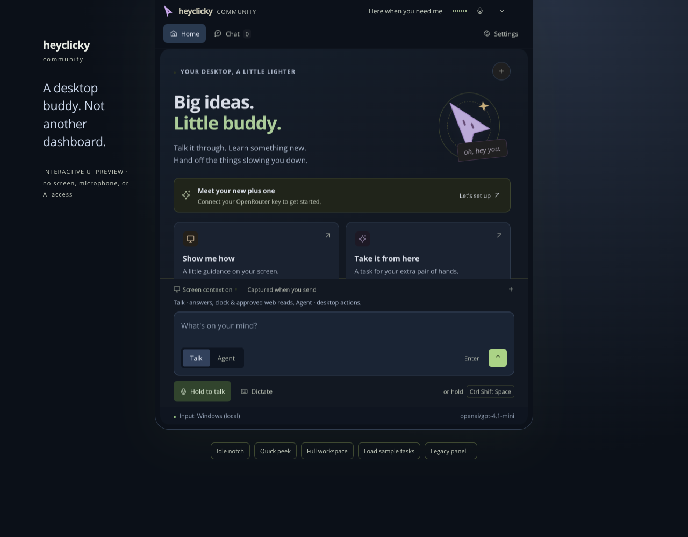
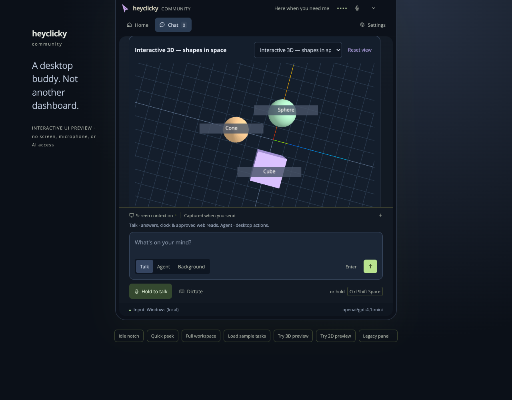

# HeyClicky Community for Windows

An independent, open-source **Windows 10/11 desktop AI buddy**, inspired by the interaction style of [HeyClicky](https://www.heyclicky.com/). Talk about your screen, get on-screen guidance, dictate into other apps, and ask an agent to perform desktop tasks—with approval before actions.

**Not the official HeyClicky app and not a full replacement for its hosted service.** No official code, branding assets, accounts or private APIs are used. See the feature comparison below. Built from the attached Windows app specification.



## New in 1.6.0 — research, documents, visual answers & background workers

- **Web research:** `search_web` discovers up to six source leads via DuckDuckGo public HTML search; `fetch_url` reads approved HTTPS sources as bounded text with source/retrieval context. Search and every source fetch require approval. Search is best effort: bot checks, service changes, redirects, dynamic pages and paywalls can block it. Snippets alone are not verified facts. Your query goes to DuckDuckGo and source contents go to your chosen model; no paid search key is required or reliability guaranteed.
- **Real files:** `create_document` exports **DOCX, PDF, Markdown and text** with explicit path/content approval. DOCX supports basic headings/bullets/paragraphs; PDF uses escaped, offline content and an isolated, JavaScript-disabled print renderer. Body limit is 32,000 characters; the tool refuses to overwrite existing files. Review content/layout before sharing. The separate existing `write_file` tool can still overwrite files with explicit approval. No Office installation is required for export.
- **Visual answers:** `show_visual` renders 2D bar charts/diagrams and **interactive 3D primitive scenes** inside the notch. Drag to orbit, scroll to zoom, right-drag to pan, reset the view and switch between up to eight session visuals. Three.js is bundled locally; there is no CDN, generated JavaScript, HTML, external asset loading or arbitrary 3D model import. Graphics are explanatory, not CAD, physics simulations or verified measurements. 3D requires WebGL; use 2D/text if graphics are unavailable.
- **Background mode:** up to **two concurrent off-desktop research/writing workers**, with independent text histories, task cards, results, follow-ups and cancellation. They can search/read sources, draft code/text, create approved documents/files and produce visuals while you continue using Talk or your computer. They cannot see the screen, click/type, open browsers or run shell commands. Every data/file/network operation still asks; approvals are serialized and tied to the right job. Each worker is bounded to 12 model turns and 15 minutes and consumes your OpenRouter credits. Jobs are session-only and stop on app quit. Desktop-control agents remain serialized and use your active desktop—not isolated virtual computers.

### Try it from the notch

- **Talk:** “Research recent developments in [topic]. Compare sources and cite URLs.” Approve search/source requests; do not treat failed or blocked research as verified.
- **Talk or Agent:** “Create a DOCX report in my Documents folder about [topic], with source links.” Review the output path/content approval. Use a new filename; exports never overwrite.
- **Talk:** “Explain a cube and sphere using an interactive 3D scene.” Or “Show this data as a 2D chart: …”. Visuals appear in the conversation and can be revisited during the session.
- **Background:** select the **Background** mode beside Talk/Agent, then send a research/writing task. Submit another to use the second worker. Task cards and approval cards remain in the notch. **Stop** cancels all active/queued work; a task’s Stop cancels only that job. Do not expect unattended execution across approvals, restart or sleep.



### Dark workspace, clock/tool fixes & hidden Edge (introduced in 1.5)


- **Dark throughout:** notch, fallback panel and Edge setup use dark surfaces, stronger contrast, readable 12–14px controls/body text, larger touch targets and viewport-bounded scrolling. The expanded native notch is now up to **704 × 800** logical pixels, clamped to the available display. Approval arguments scroll independently and action buttons stay reachable. The screenshot above is a browser design preview, not proof of Windows hardware behavior.
- **Real clock answers:** simple questions such as “what time it is in Dubai?” are answered locally from the device clock using `Asia/Dubai`, not training data. Other timezone questions can use the new `get_time` tool in either mode, with IANA daylight-saving rules. Clock accuracy depends on Windows date/time synchronization. No clock network service/key is needed; normal chat setup still uses your OpenRouter key.
- **Tool-calling fixes:** require a tool-capable OpenRouter route, normalize supported response formats, reject malformed/truncated tool calls, and send all batched tool results before screenshot messages. Talk supports clock, screenshots/drawing and **approved HTTPS reads**; desktop actions still need Agent mode. Latest tool activity is visible. Unsupported models now get actionable errors instead of silently ignoring tools. These are protocol/regression fixes, not a promise that every model will choose the right tool or operate your desktop correctly.
- **Experimental hidden Edge window:** after the existing visible permission/test/background approval, choose **Background window behavior → Hidden window**, save, then **Move helper to background**. Only the dedicated helper window is hidden from the desktop/taskbar; Edge stays running, Windows microphone indicators remain, and a window may briefly appear during launch. **Open visible Edge setup** restores hidden/minimized windows. Minimized remains the default/recommended mode. This is not headless: hidden recognition can suspend/fail and may need another visible gesture. If it fails, restore setup or use minimized/Windows input. Live hidden recognition must be tested on your Windows machine.

### Optional Microsoft Edge voice input (introduced in 1.4)


- **Real Edge Web Speech recognition**, not Electron speech or a paid speech API. Windows speech remains the default and fallback. Edge needs installed Microsoft Edge, internet and supported language/service availability; there is no separate speech API key and no unlimited/free-service or accuracy guarantee.
- **Visible first-time setup:** grant microphone access and complete a real recognition test in a dedicated Edge profile. Only then can you explicitly enable future minimized launches. The stable site/profile usually remembers permission, but may ask again.
- **Minimized, not invisible/headless:** Edge stays running and microphone indicators remain intact. Browser updates, policies, network errors, suspension or user-gesture requirements can interrupt recognition. A fallback notice asks you to repeat with Windows; released turns and already delivered dictation are never replayed.

### The notch workspace (introduced in 1.3)


- **Home, Chat and Settings inside the notch**, including the API-key form, speech diagnostics, hotkeys, privacy preferences and complete approval cards. The old desktop panel is only a fallback when the notch is disabled.
- **Three native window sizes:** small idle capsule, non-activating hover peek, and a focusable expanded workspace. Hover never takes typing focus; deliberately opening Chat/Settings enables input. Collapse shrinks the real native input area, not just its visible contents.
- **True hold-to-talk:** hold the global Talk/Agent shortcut or the on-screen microphone button, wait for Listening, speak, and release to finalize. Pauses while holding do not submit. Short taps, releasing before readiness, pointer cancellation, and Stop discard the turn. Partial transcripts use real recognition events. The waveform uses real Windows audio levels; Edge does not expose audio levels, so it is not simulated for Edge input. The top microphone icon remains a tap-and-pause alternative.
- **Session task cards:** queued/running/approval/done/failed/stopped states, observed tool activity, results and follow-ups with independent task text context. Desktop jobs deliberately run **one at a time**; they are not parallel computer-control agents. The peek keeps progress visible when the full workspace is tucked away. Stop cancels the active and queued work; individual queued tasks can also be cancelled.
- **Readable teaching overlays:** numbered explanation cards and optional bottom-screen answer captions. Captions show a bounded response excerpt, not word-synchronized subtitles. Drawings remain click-through; the notch is excluded from screenshots and desktop input.
- **Refined interface:** consistent SVG icons, warm neutral surfaces, softer accent colors, better spacing, reduced-motion support, and an interactive, clearly labelled browser preview. No sample tasks are shown unless explicitly loaded in preview controls.

## Download & run

1. Open this repository's **[Windows installer workflow](https://github.com/victor123258/HeyClicky/actions/workflows/windows.yml)**.
2. Select the latest **successful** run for `arena/d603b909-heyclicky` (or `main` after merging). Download **HeyClicky-Windows-x64** from the Artifacts section. GitHub requires you to sign in to download workflow artifacts. Extract the ZIP.
3. Double-click **`HeyClicky-Setup-1.6.0.exe`**. The per-user installer needs no administrator permission, creates shortcuts, and launches the app. Or run **`HeyClicky-Portable-1.6.0.exe`** without installation.
4. On first launch, paste your own [OpenRouter API key](https://openrouter.ai/settings/keys) in Settings, choose a vision/tool-capable model, and click **Save settings**, then **Test saved connection**. Your OpenRouter account needs credit. The test checks text access; image/tool support is checked during actual use.

The installer is **unsigned**. Windows may show SmartScreen or your organization may block it. Verify that you downloaded it from your own trusted build; do not disable security protections. Code signing and automatic updates are not configured. Workflow artifacts expire after 30 days; rerun the workflow to rebuild. Executables are generated by CI, not committed to Git.

**Requirements:** x64 Windows 10/11, internet access to OpenRouter and your chosen model, microphone for voice, Windows PowerShell 5.1 and a Windows speech-recognition language pack for local input/fallback, or Microsoft Edge for optional online input. This is an Electron app; Node.js is **not** needed to run the installer or portable executable.

## What is implemented

| Capability | This build |
|---|---|
| Screen-aware conversation | Typed, Windows local or optional Edge online speech input, OpenRouter vision models, spoken Windows voice output |
| Teaching and on-screen guidance | Labelled pointers, boxes, arrows, circles, numbered explanation cards and optional answer captions |
| Top-of-screen notch | Idle, hover-peek and full Home / Chat / Settings workspace on the primary display; focus only on explicit expansion |
| Task cards | Session queue, observed activity, exact-argument approvals, results, cancellation and per-task text follow-ups |
| Cursor buddy | Original cursor character follows your mouse, changes color with state and moves to annotations |
| Voice agents | Agent hotkey or `agent …` prefix starts a bounded tool loop |
| Desktop actions | Click, double/right click, Unicode typing and SendKeys; uses the selected display's coordinates |
| Agent tools | PowerShell, bounded text-file reads/writes, HTTPS text fetch, browser URLs, fresh screenshots and drawings |
| Dictation | Windows or Edge speech recognition types into the currently focused application |
| Safety | Exact-argument Allow/Deny card, two-minute approval timeout, Stop button and global stop hotkey |
| Multi-monitor | Capture the display under the mouse at the start of a request; overlay on each display; Windows DPI coordinate conversion |
| Preferences | Model ID, Windows voice/rate, hotkeys, screen context, speak answers, cursor buddy, desktop approval toggle, launch on login |
| Desktop lifecycle | Single instance, tray controls, close-to-tray, one-click per-user installer and portable executable |
| Privacy | DPAPI-encrypted API key; in-memory conversation/screenshots; delete local key/settings and quit |

### Not included / different from official HeyClicky

- No official account login, subscriptions, Free/Pro/Max plans, credits or backend. **You pay OpenRouter for usage**; this app adds no subscription.
- **No native Gmail, Notion or Google Sheets OAuth connectors.** Desktop/browser automation is not equivalent to those integrations. Do not give the agent passwords, tokens or session cookies.
- Turn-based speech, not a hosted realtime voice stream. Speech accuracy and languages depend on the selected provider. Edge input may send audio to Microsoft; Windows local input needs installed recognizers. It does not listen for a wake word.
- No signed installer, updater or macOS build. No guarantee of exact visual or behavioral parity with the official app.
- No conversational memory between launches. Activity is session-only. No arbitrary imported 3D models/CAD, image search cards, routines, Chrome extension, or concurrent desktop-control agents. Version 1.6 adds bounded structured 3D scenes and concurrent off-desktop research/writing workers. These are not implied by the UI redesign.

## Everyday use

| Default hotkey | Action |
|---|---|
| **Ctrl+Shift+Space** | Hold, wait for Listening, speak, then release to send. |
| **Ctrl+Shift+A** | Hold to speak an agent task; release to queue it. |
| **Ctrl+Shift+D** | Start/stop dictation into the active window. |
| **Ctrl+Shift+H** | Open/collapse the notch workspace. |
| **Ctrl+Shift+X** | Stop listening, speaking, requests, pending approvals and agent work. |
| **Escape** (workspace focused) | Stop everything. Escape is not a global shortcut. |

Type a question and press Enter (Shift+Enter for a new line). **Talk** can check the clock, see the screen/draw, and fetch a public HTTPS source after approval; it cannot click, type or execute commands. **Agent** enables desktop tools. Saying or typing `agent` at the beginning also selects agent mode. Use Chat → Clear to clear the session after stopping active work. The plus buttons start a new input/thread without deleting history. Collapsing the notch keeps the tray running; use **Quit** in the tray to fully exit.

### Set up optional Edge input

1. Stop active voice/tasks. Open Settings → Voice & listening, choose **Microsoft Edge**, and enter an input language such as `en-US`. Edge language availability is independent of Windows recognition packs; support for a tag (including `bn-BD`) is not guaranteed.
2. Click **Open visible Edge setup**. This uses a dedicated `%APPDATA%\heyclicky-community\edge-voice-profile`, never your personal browser profile. Its stable origin is `http://127.0.0.1:21843`. If that port is occupied, setup fails rather than changing the permission origin.
3. In the visible helper, click **Allow microphone & test Edge speech**, grant permission, say a sentence and pause. This tests actual recognition—not merely browser API presence—and makes no AI request. Audio may be processed by Microsoft's online speech service, including during this test.
4. Optionally check the disclosure and choose **Enable background use & minimize** after a successful test. Otherwise keep the helper window open for voice input. This is not a silent/headless service and cannot bypass permission or hide recording indicators.
5. Back in app settings, **Save settings**, then use **Test microphone** or hold-to-talk. The input source and helper status are shown. If fallback is enabled, an Edge failure before finalization switches to Windows and asks you to repeat after Listening appears. Windows fallback still requires an installed recognition language pack. No fallback occurs after release or delivered dictation.
6. **Close helper** disconnects Edge and stops its recording; later use may relaunch it if minimized launches were approved. **Disable automatic minimized launches** revokes that launch preference but does not close an already open helper. To stop all Edge use, close the helper and save Windows as your provider. Quit also requests closure of only the dedicated helper window.

Permission can be remembered for the stable origin/profile, but updates, cleared permissions or policies can prompt again. Minimized recognition can stop or require another visible gesture. Use the visible setup again or select Windows input. No direct/private Microsoft speech endpoint is used. Hidden-window mode is optional and experimental; it is not a way to guarantee headless recognition or permanent permission. Microsoft/Edge service terms and retention apply; an AI key is never passed to this browser.

### Tool calling & current facts

Use a model/provider that supports **function tools**; with screen context enabled it must also support images. The app requests compatible parameter support from OpenRouter. If the selected model is text-only, turn Screen context off. A tool-route or credit error is not repaired by switching providers silently or removing tool safety checks. Try the default model ID if your custom model rejects tools.

- **Talk:** clock/timezone answers, screenshot/drawing, approved HTTPS reads. Try “What time is it in Dubai?” to check the local clock path.
- **Agent:** clicking, typing, keystrokes, files, commands and opening URLs under the existing approval policy. Select Agent for desktop work; Talk intentionally cannot execute those actions.
- Batched calls now return matching tool IDs in order before attaching new screenshot messages. Tool results remain bounded and cancellation/denial still stop execution.
- Version 1.6 adds best-effort public HTML web search for source discovery. Search may be blocked; provide a public HTTPS source if it fails. An inaccessible page, dynamic website or failed fetch is not a verified answer. No live model or physical desktop acceptance is claimed by the automated tests.

### If Windows voice input does not work

1. Open Settings → Voice & listening → **Find languages**. Windows speech recognition requires an installed recognition engine; a text-to-speech voice is **not** enough. Install a Speech pack under Windows Settings → Time & language → Language & region → Language options if none are listed. Only languages supported by Windows' System.Speech engine appear; not every Windows display/typing language supports recognition.
2. Select an installed **Recognition language**, then **Save settings**. Automatic uses your Windows UI language if installed, otherwise the first installed recognizer. The output voice is a separate setting.
3. Open **Microphone permissions** and enable both microphone access and **Let desktop apps access your microphone**. Under **Input device**, choose and test your microphone. The app uses Windows' default input, not an independently selected device.
4. Click **Test microphone**. Wait for **Listening · language** before speaking. Pause at the end. The result should show **Heard: …** without calling AI. Stop cancels it.
5. If the local test works, add your OpenRouter key. Hold Talk, wait for Listening, speak, then release. Recognition continues across pauses until release (bounded to about 85 seconds). The small top microphone icon and microphone test use the tap-and-pause path. If keyboard release monitoring fails, use the on-screen hold button or restart. Modifier combinations with letters, numbers, function keys, Space, Enter, Tab and navigation keys are supported for global hold shortcuts.

For dictation, put focus in the destination app **before** pressing the global hotkey. It types literal recognized text followed by a space; spoken punctuation commands are not implemented. Text goes to whichever window is focused, not necessarily the one visible at start. Do not change focus to a sensitive field while dictating.

### Approvals and emergency stop

- Clicks, keystrokes and typing ask by default. The card shows **exact tool arguments**, including commands and file contents. After Allow, the panel/notch hide to return input to the underlying app. Verify the target app before approval.
- Commands, file reads/writes, HTTP(S) browser links and HTTPS fetches **always ask**, even if desktop approvals are disabled. File contents, command output and fetched text go to the selected model as tool results.
- Fresh screenshots and annotations do not ask separately: they are part of the screen-context request. Turn **Screen context** off for text-only conversations; screenshot tools then fail closed. No background periodic screen capture.
- Denying an action stops that agent task. Pending approval automatically denies after two minutes. No “allow everything” button.
- The agent is bounded to 12 model turns (at most 8 tool calls per turn), commands time out after 30 seconds, file reads are limited to 32 KB and writes to 32,000 characters, web results to 32 KB. Fetches do not follow redirects.
- Stop aborts network requests, rejects approvals, clears annotations and terminates native helper process trees. **Already performed changes cannot be undone.** A command that launches a detached program/service may outlive its parent; this is not an OS sandbox.
- Agents can misread screenshots, click incorrectly, and encounter prompt injection. The prompt treats screen/file/web content as untrusted, but prompts are **not a security boundary**. Keep approvals on, use least privilege, avoid secrets, and review every command.

### Privacy & storage

The app sends the current request, recent conversation text (per-task context for agent follow-ups), requested screenshot, and approved tool results directly to `https://openrouter.ai/api/v1/chat/completions`. OpenRouter forwards them to your selected model provider. Retention depends on [OpenRouter privacy settings](https://openrouter.ai/settings/privacy) and the provider. No app-owned AI backend or telemetry is configured.

Screenshots are JPEGs kept in process memory and not intentionally written to disk; OS paging/crash handling and remote providers are outside this guarantee. Prior screenshots and raw tool payloads are not retained in conversation history. Settings and an encrypted key are stored in Electron's Windows user-data folder (normally `%APPDATA%\heyclicky-community\settings.json`). DPAPI encryption is tied to your Windows user; no plaintext fallback. The portable executable also uses this folder and is **not fully self-contained**. Global hold-to-talk uses a local helper that polls only the configured Talk/Agent key combinations for release; it does not record arbitrary typing or send keyboard events anywhere. With Windows input, audio and partial transcripts stay local until a completed voice request is submitted. With optional Edge input, audio may be sent to Microsoft during recognition (including tests, partial speech and subsequently cancelled turns); Stop cannot retract already processed audio. Partial transcripts are not submitted to the AI before release. The Edge helper receives only voice commands/language and a per-run local capability—not your OpenRouter key, screen or conversation. Its dedicated browser profile persists permission/site data; browser caches and Microsoft retention are outside the app’s in-memory-transcript guarantee.

Settings → **Delete local data** requests closure of the dedicated Edge window, removes its profile/remembered site permissions, and clears the saved key/settings, conversation, Electron cache and browser storage, disables login startup and quits. If the Edge profile is locked, deletion reports a retryable error before deleting your saved key/settings. It does not delete files an agent created, remote provider records, or the installed app itself. Uninstall the installed version from Windows Settings.

## Build from source (Windows)

Node.js 22 LTS and Git are needed for development only.

```powershell
npm ci
npm run check
npm test
powershell.exe -NoProfile -ExecutionPolicy Bypass -File scripts/windows-smoke.ps1
npm start
# Build both executables into dist\:
npm run dist -- --publish never
```

`npm run dist` uses electron-builder/NSIS. Windows CI runs the same syntax/tests/native smoke checks and builds both executables. No signing secrets or API keys are needed for a build. The installer bundles Electron and all runtime code; your API key is entered only on your PC after installation.

For a **UI-only browser preview** on any platform:

```sh
npm ci
npm run preview
# http://localhost:3000
```

The preview clearly labels itself, performs no AI calls, captures no screen and has no desktop access. Do not enter real keys there. Native desktop features need Windows.

### Project layout

```
src/main/index.js       Windows lifecycle, IPC, approvals, captures and tool execution
src/main/lib/          Testable model client, bounded agent, schemas and encrypted settings
src/main/native.js     Bounded PowerShell process execution and cancellation
src/main/speech.js     Bounded, cancellable Windows speech helper lifecycle
src/main/voice.js      Provider selection and guarded fallback
src/main/lib/clock.js  Device clock / IANA timezone answers
src/main/edge-voice.js Authenticated loopback bridge and dedicated Edge lifecycle
src/edge-voice/        Visible Edge permission/test/consent helper
src/main/notch.js      Three-state notch workspace and capture/input suspension
src/main/keys.js       Scoped voice-shortcut release monitoring
src/main/lib/tasks.js  Session task queue, lifecycle and follow-up context
src/preload/           Narrow context-isolated, sandboxed IPC bridges
src/renderer/          Conversation, settings, activity and click-through overlay UI
scripts/*.ps1          Windows speech, Unicode input and native smoke tests
test/                  Node test runner: agent safety, settings, tools, HTTP and DOM flows
.github/workflows/     Windows build + downloadable installer artifacts
```

## Validation and known limits

Automated tests cover denial, cancellation during approval, talk-mode isolation, tool argument validation, step limits, encrypted-key round trips, HTTP error handling, and browser DOM interactions. CI also parses PowerShell, compiles/probes native input, held-speech, Edge-window and key-release helpers without opening a microphone, enumerates installed voices and speech-recognition engines, and launches the actual Electron panel/notch with isolated user data to verify startup, expansion/collapse, and the restricted notch IPC bridge. These do **not** prove live desktop/microphone behavior or model quality.

Before distributing broadly, run [the Windows acceptance checklist](docs/WINDOWS-TESTING.md) on an actual Windows 10/11 machine with a microphone, OpenRouter credit and mixed-DPI monitors. No live paid model call or physical microphone test was run in the Linux coding workspace.

Other limits: the desktop agent uses screenshot coordinates, not Windows UI Automation; dynamic UIs and elevated/secure windows may block or misdirect input. It runs with your current user's permissions and never requests elevation. Windows speech language packs, hotkey conflicts, enterprise execution policies and screenshot restrictions can prevent features from working. HTTPS fetch extracts bounded text from HTML, but does not run a JavaScript browser. Best-effort web search is a separate approval-gated tool. A disconnected capture display requires a new task. Some OpenRouter models do not support both images and tools.

## License

MIT. Original icon and UI artwork are included. Independent community project, not affiliated with official HeyClicky.
